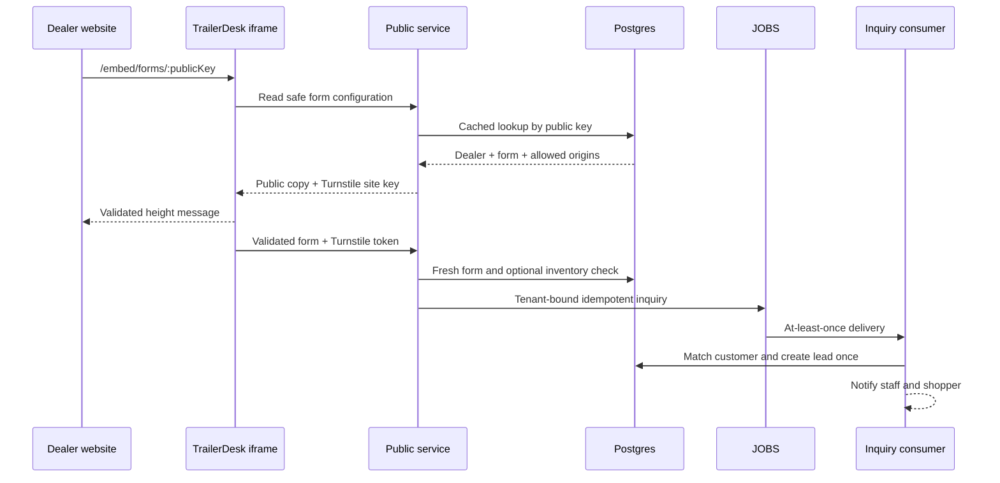

# Embedded forms

Dealer websites load `/embed/v1.js` with a `data-form-key`. The small, versioned loader
creates an iframe at `/embed/forms/:key`, validates resize messages by source and origin,
and contains no dealership secrets. Hosting the UI on TrailerDesk avoids CSS conflicts,
cross-origin cookies and one Turnstile hostname per dealer.

The public key identifies the form but is not a secret. The service derives the
dealership from the fresh database record; it never accepts `dealershipId` from the
browser. Configuration responses omit internal IDs and allowed-origin administration.
The iframe response builds `Content-Security-Policy: frame-ancestors` from validated
HTTP origins. Production origin changes are dealership configuration changes, not env
variables.

Submission uses shared Zod schemas on both sides, server validation, Turnstile, a rate
limit keyed by form and IP, and a client request UUID. Queue delivery is at least once;
`(dealership_id, source_key)` makes lead creation idempotent. General forms may omit a
trailer; inventory-specific inquiries validate the trailer in the same dealership.

Native-DOM embedding is intentionally not implemented. It would require dealer-origin
CORS management, direct Turnstile hostname registration, CSS isolation and a larger
compatibility surface. Add it only for a concrete integration that cannot use an iframe.
