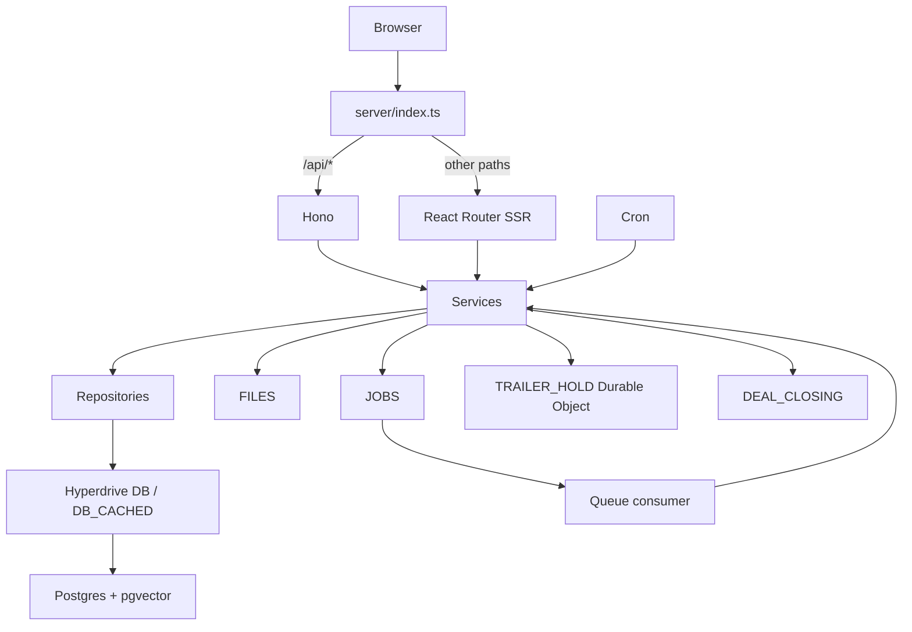

# Architecture

One Worker serves Hono APIs and React Router framework SSR. Business services enforce
permissions and call repositories. Repositories compose all business queries through
the tenant helper. Infrastructure modules never import feature code.

The same Worker has three fixed web surfaces. `ADMIN_APP_URL` serves platform operators and
their independent Better Auth realm; `APP_URL` serves dealership staff, organizations and
private APIs; `PUBLIC_APP_URL` serves `/d/*`, `/embed/*` and public APIs. The entry handler
canonicalizes safe requests and rejects cross-surface mutations. Static build and development
assets are shared. Local `admin.localhost` / `app.localhost` / `localhost` mirrors the
production hostname boundary without separate deployments.

`DB` is uncached and used for all writes, sessions, operational dashboards and
read-after-write. `DB_CACHED` is reserved for public inventory and other reads whose
user flow explicitly tolerates staleness. Hyperdrive does not invalidate cached reads
after writes; cache configuration is a cloud-resource setting, not a local simulation
guarantee.
Clients are constructed per request/job and closed by `withDatabase` in
`server/platform/db.ts`. Never use session-level Postgres features.

The diagram reflects the implemented request paths. The Phase 1 tracker separately records verification evidence and remaining checks.
